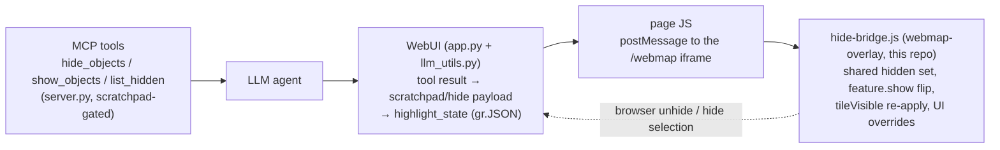

# Idea: Hide / Unhide 3D Objects by Objectid — MCP Tools for the 3DCityDB Webmap Client

## Status: proposed

The 3DCityDB Webmap Client already offers a "hide selected objects" function (right-click
selection → hide, then "show hidden objects" to bring them back). This feature would make that
capability **addressable from the MCP server**, so the agent can hide and restore individual
objects by their `feature.objectid` — e.g. *"hide the roof of the house at Main Street 5 while
we look at the walls"* or *"show everything you've hidden again"*.

Nothing in this feature touches the imported CityGML model or the database *content*: hiding is
a purely **client-side, visual** operation on the Cesium tileset. The only database change is a
new boolean column on the existing scratchpad table used to *persist* the hidden set (section 3).

> **Availability:** MCP-controlled hiding/unhiding is **only available when the scratchpad is
> enabled** (`CITYDB_SCRATCHPAD=true`). The hidden set is stored as scratchpad items (section 3),
> so without the scratchpad there is nowhere to persist it and the tools are not offered.

---

## 1. What the client already does (and what it does not)

The client library (`/app/webmap/js/3dcitydb-web-map.js`, baked into the agent image from
`tumgis/3dcitydb-web-map:alpine-v2.0.0`) exposes:

```js
webMap.hideSelectedObjects()   // hide the client's current selection
webMap.showHiddenObjects()     // show everything that was hidden
webMap.getAllHiddenObjects()   // → { gmlid: feature, ... }
webMap.getAllHighlightedObjects() // → the current selection
```

Under the hood (`Cesium3DTilesDataLayer`), hiding is a **per-feature flag**: `feature.show = false`
on the `Cesium3DTileFeature`, tracked in a per-layer `_hiddenObjects` array, and re-applied on
every tile load by the `tileVisible` event handler. Unhiding sets `feature.show = true` for all
tracked features and clears the list.

Limitations that this feature must work around:

1. **Selection-based, not id-based** — the API only acts on the client's internal selection
   state; there is no "hide these objectids" call.
2. **All-or-nothing unhide** — no "show these specific ids".
3. **Volatile** — purely client-side state; any viewer or tile reload (this app does both:
   "Refresh 3D tiles", post-import reload) wipes the hidden set.
4. **Baked into the image** — the client JS is not part of this repository and cannot be
   patched. But the page-level `script.js` delegates its buttons to the webmap instance:
   `function showHiddenObjects() { webMap.showHiddenObjects(); }`. Since `hide-bridge.js` loads
   *after* `script.js` and runs in the same page scope, it can **override those instance methods**
   (section 2.3) — no patching of the shipped client needed.

## 2. How this would be achieved

### 2.1 A single shared hidden set

There is **one** hidden set, per user, and **both** the browser UI and the agent drive it. This
is the core of the design (decided in discussion):

- If the user clicks "unhide" in the browser, the agent's hidden items are affected, and vice versa.
- "Unhide" therefore means **unhide everything hidden, regardless of who hid it** — there is no
  provenance to track per id.
- The browser's native *hide* stays **selection-based and per-feature** (it hides exactly what was
  right-clicked — typically a surface or the solid); the agent tools are the **per-object** control
  (section 3.3). They complement each other.

### 2.2 Storage: scratchpad FeatureSet rows + a new `hide_features` column

The hidden set is persisted in the existing [scratchpad](scratchpad.md) table, so it is already
**per-user, persistent (survives reload), queryable, and audited** — no new schema, role, or
isolation machinery needed.

- A hidden group is a scratchpad **FeatureSet** row (the existing `objectids text[]` column holds
  the objectids) with a new **`hide_features boolean`** column set to `true`.
  Semantics: *"the `objectids` in this set should be hidden in the viewer."*
- This is distinct from the existing `is_visible` column: `is_visible` controls whether the
  *item itself* shows in the list/scene; `hide_features` controls whether the *referenced
  3DCityDB features* are hidden.
- The bootstrap already applies `ALTER TABLE … ADD COLUMN IF NOT EXISTS …` (that's how `class`
  was added), so adding `hide_features` (default `false`) is cheap and idempotent. The
  `my_scratchpad` `security_barrier` view gains the column.
- Because the scratchpad payload is **already sent to the viewer every turn** and the bridge
  already round-trips show/hide/delete actions, the **bidirectional sync (2.3) falls out
  naturally**: browser unhide → up to the server → set `hide_features = false` (or delete) on
  the row(s) → next-turn payload → bridge. One source of truth in the DB, both directions through
  existing channels.

### 2.3 Bidirectional sync (browser UI ↔ agent)

`hide-bridge.js` loads after `script.js` and owns the page. It:

1. **Overrides `webMap.hideSelectedObjects` and `webMap.showHiddenObjects` on the instance.** The
   client's own right-click / "show hidden objects" buttons still fire — but now run our code:
   - *Hide*: capture the current selection's objectids (`webMap.getAllHighlightedObjects()` /
     `_prevSelectedFeatures`), fold them into the shared set, push the change **up** to the server
     (the scratchpad bridge's existing viewer→parent `postMessage` → `scratchpad.apply_action`),
     and re-apply `feature.show` from the shared set.
   - *Unhide*: unhide **all** (clear the whole set), push up, re-apply.
2. **Receives the agent's hide/show** via the same scratchpad payload channel (a `hide_features=true`
   FeatureSet row) and applies it.
3. **Re-applies on every `tileVisible`** event, so newly streamed tiles respect the current set.

The bridge must also coexist with the highlight/isolate style: `feature.show` and
`Cesium3DTileStyle.show` are independent (both must be true for a feature to render), so an
agent-hidden feature stays hidden after a highlight passes, and unhiding it simply returns it to
whatever the current highlight/isolate mode dictates.

### 2.4 Pipeline (all existing)



| Layer | Existing precedent | What we'd add |
|---|---|---|
| **MCP tools** (`src/citydb_mcp/server.py`) | `resolve_highlight_targets`, `scratchpad_action`, `flood_scene_set_water` | `hide_objects`, `show_objects`, `list_hidden` (offered only when `scratchpad.enabled()`) |
| **WebUI** (`app.py` ~L1278, `llm_utils.py`) | `build_scratchpad_payload`, `extract_flood_scene` → `highlight_payload` | include `hide_features` FeatureSet rows in the scratchpad payload |
| **postMessage** (page JS `_sendHighlight`, app.py ~L3121) | `{type:"scratchpad"}`, `{type:"reload_tiles"}` | the scratchpad payload already carries the rows — no new message type needed |
| **Viewer bridge** (`webmap-overlay/`) | `scratchpad-bridge.js` (item visibility, `tileVisible` re-apply, round-trip), `highlight-bridge.js` (id matching) | `hide-bridge.js`: shared set, id matching (reused), `feature.show` flip, `tileVisible` re-apply, `webMap.*` overrides |

## 3. Tool surface

All three tools are offered **only when the scratchpad is enabled** (like the other scratchpad
tools), are read-only with respect to the database content, and take at most 200 ids
(`MAX_OBJECTIDS`).

```
hide_objects(objectids: [GML ids], include_parts: bool = true)
    Hides the given features in the 3D viewer, persisted as a scratchpad group
    (FeatureSet with hide_features=true). include_parts (default true) also hides all of the
    feature's descendant sub-parts that exist in the tileset (see 3.3). Returns which ids were
    hidden, which were expanded to which tile ids, and which were not found / not tileable.

show_objects(objectids: [GML ids] | "all")
    Shows the given features again, or everything the user has hidden ("all"). When given
    objectids, clears them from the relevant group(s); "all" unhides every group.

list_hidden()
    Returns the groups (names + objectids) currently hidden, so the agent can answer
    "what's hidden?" from ground truth.
```

Result shape mirrors `resolve_highlight_targets` (`resolved` / `missing` / `not_tileable`) so the
agent can answer "that objectid doesn't exist in the tileset".

### 3.1 Hidden groups appear in the "My items" list

Hidden groups are **shown** as items in the scratchpad's "My items" list (decided), styled
distinctly (e.g. dimmed / an "eye-closed" marker), each with its own **unhide** action. This makes
groups discoverable and lets the user unhide a single group independently — the same per-row
show/hide/delete UI the scratchpad already has, with the row's action wired to
`hide_features` instead of `is_visible`.

### 3.2 Default is configurable later

`include_parts` defaults to `true` (decided). A future environment variable in `.env`
(e.g. `SCRATCHPAD_HIDE_INCLUDE_PARTS`) could set the default behaviour without a code change.

### 3.3 Whole-building vs. parts-only hiding (`include_parts`)

One tool with an optional parameter — not a separate `hide_object_completely` method (a second
near-identical tool would just force the LLM to pick between duplicates):

- **`include_parts=true` (default)** → hide the object **and all its descendant features** that
  exist in the tileset. The "make this building disappear" intent.
- **`include_parts=false`** → hide **only** the named objectids.

| Intent | Call |
|---|---|
| Hide the building completely (solid + roof + walls) | `hide_objects([building_id], include_parts=true)` |
| Hide just the roof surfaces, keep the rest for inspection | `hide_objects([roof_surface_id], include_parts=false)` |
| Hide the merged solid but keep the individual surfaces ("hollow" building) | `hide_objects([building_id], include_parts=false)` |

**"Parts" resolution** reuses existing machinery: `resolve_highlight_targets` already walks the
CityGML hierarchy to expand a feature into the objectids actually present in the tileset, and
`get_feature_tree` already exposes the containment neighbourhood. We need the **downward /
descendant** variant of that walk (the feature itself + all tileable descendants).

**The solid-vs-surfaces caveat (by design, not a bug).** By default the tiler exports *all*
geometries stored with a CityGML feature as their own 3D Tiles objects, so a building typically
appears twice in the tileset: the merged `lod2Solid` (carrying the *building's* objectid) **and**
the individual `RoofSurface` / `WallSurface` / … features (their own objectids). Both render.
Therefore hiding only the `RoofSurface` objectid leaves the roof still visible inside the
`lod2Solid`. **This is acceptable**: the tool hides exactly the tile features whose objectid is in
the (part-expanded) set, and `resolve_highlight_targets` / `get_feature_tree` tell us precisely
which objectids exist — users can configure their tiler however they like, and "hide the roof
surfaces" may still leave the LOD2 solid's roof visible.

> **System-prompt hint (decided):** add a line to the generated system prompt so the agent, when
> it hides features, reminds the user that **parts of an object may still remain visible** (because
> the object's geometry can also be rendered by its `lod2Solid` or by sibling features) and states
> this in the final answer. This is important because users cannot otherwise know why "hiding the
> roof" didn't fully remove it.

**Scale note.** `include_parts` on one building is small (dozens of ids). But "hide all buildings
of class X in a district" can be tens of thousands of ids — enumerating objectids is the wrong
tool there. That is where the scratchpad FeatureSet model helps as a *follow-on extension*: store
the *predicate* (a query, e.g. "all `building` in district X") plus an `include_parts` flag and
re-resolve on load, instead of a giant id list. Out of scope for v1.

## 4. Interaction with the client's own hide function

With the shared set (section 2.1) and the `webMap.*` overrides (section 2.3), the client's native
right-click hide and the agent's tools operate on **the same** hidden set — no divergence, no
"last writer wins" corruption (the underlying flag is boolean). The browser stays a precise
per-feature control; the agent is the per-object control.

## 5. Integration touchpoints (files)

| File | Change |
|---|---|
| `src/citydb_mcp/tools/scratchpad.py` | add `hide_features boolean` column to DDL + migration + `my_scratchpad` view; helpers to read/update hidden groups |
| `src/citydb_mcp/server.py` | 3 new `Tool` entries (offered only when `scratchpad.enabled()`) + dispatch in `_execute_tool` |
| `src/citydb_mcp/tools/highlight.py` (or new `tools/hide.py`) | descendant/id expansion reusing `resolve_highlight_targets`; no DB access for hide itself |
| `production/webui/llm_utils.py` | include `hide_features` rows in the scratchpad payload sent to the viewer |
| `production/webui/app.py` | wire the new tools' results into the per-turn payload (largely already handled by the scratchpad payload path) |
| `production/webmap-overlay/hide-bridge.js` (new) | shared set, id matching (shared helper), `feature.show` flip, `tileVisible` re-apply, `webMap.hideSelectedObjects`/`showHiddenObjects` overrides, round-trip to the server |
| `production/webui/…` system prompt | the solid-vs-surfaces visibility hint (3.3) |
| `production/docker/Dockerfile` | add `<script src="hide-bridge.js">` to the `sed`-injected script list (overlay files are `COPY`ed wholesale, so nothing else) |
| `production/docs/hide-objects.md` + `README.md` | usage docs, like the other viewer features |

## 6. Effort estimate

- `hide-bridge.js` (shared set, `tileVisible` re-apply, `webMap.*` overrides, coexistence with
  highlight/flood): **~200–300 lines** — the main piece.
- scratchpad column + view + helpers; 3 MCP tools; WebUI payload wiring: mostly following the
  existing scratchpad pattern.
- System-prompt hint + docs.

**Total: roughly one to two days** (the bidirectional sync and UI overrides are the non-trivial
part). The optional `SCRATCHPAD_HIDE_INCLUDE_PARTS` env knob and the predicate/large-set
extension are small follow-ups.
