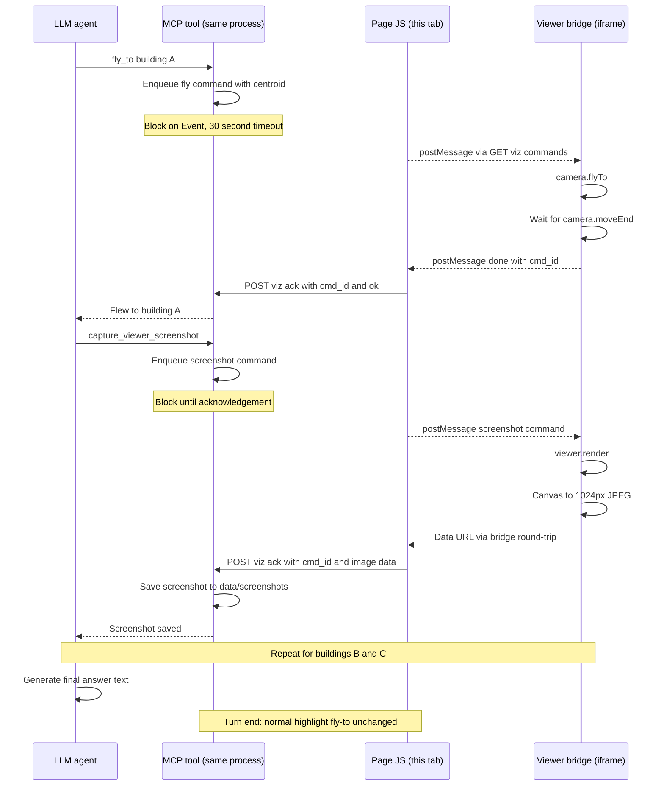

# Idea: 3D Viewer Screenshots as MCP Tools — Capturing the Cesium View into the Chat and PDF Export

## Status: proposed

Let the agent capture **screenshots of the 3D viewer** (just the Cesium view, nothing else)
via MCP tools and have them embedded into the generated answer — visible in the chat window and
in the PDF export of the chat. The canonical acceptance scenario:

> *"Fly to the three tallest buildings one after another and make a screenshot of each."*

The agent issues six sequential, **blocking** tool calls (`fly_to` + `capture_viewer_screenshot`
×3); the final answer is printed with three captioned screenshots appended at the end. The
normal end-of-turn highlight fly-to still happens afterwards, unchanged.

> **Invariants (decided in discussion):**
>
> - The image **bytes never enter the LLM context** — not as base64, not as a tool result. The
>   model only ever sees a short URL line. The image is inside the *chat window* (rendered
>   markdown) and the PDF export, and outside the *context* (what later turns send to the LLM).
> - Screenshots show **only the 3D viewer** (the Cesium canvas), not the chat UI.
> - The **automatic end-of-turn highlight + fly-to is untouched**: it runs after the answer is
>   printed, by which time all fly/screenshot pairs have completed. No suppression or
>   special-casing is needed (see [Timing and the end-of-turn highlight](#timing-and-the-end-of-turn-highlight)).

---

## 1. What the client already does (validated capture primitive)

The shipped 3DCityDB Webmap Client already contains a working screenshot function
(`script.js` in the image `tumgis/3dcitydb-web-map:alpine-v2.0.0`, verified in the running
container):

```js
function createScreenshot() {
    cesiumViewer.render();
    const imageUri = cesiumViewer.canvas.toDataURL();   // PNG data URL of the Cesium canvas
    // …opens a popup window with the  (printCurrentview() prints it)
}
```

Two facts make this directly reusable:

1. **The capture recipe works without `preserveDrawingBuffer`.** The client's
   `Cesium.Viewer` options do **not** set `preserveDrawingBuffer: true`, yet
   `render()` → `canvas.toDataURL()` in the same synchronous task reliably yields the current
   frame. So no workaround, no `postRender` gymnastics, no GPU-specific testing is required —
   the bridge replicates those two lines (both `cesiumViewer` and the client are page globals
   visible to our overlay scripts, the same way `highlight-bridge.js` uses them).
2. **The canvas *is* the 3D viewer** — nothing else. Capturing `cesiumViewer.canvas` satisfies
   "just the 3D viewer" by construction.

What we adapt instead of reusing verbatim: downscale to ~1024 px wide and re-encode as
**JPEG q≈0.7** (a full-res PNG of this viewer is 1–3 MB; the resized JPEG is ~100–200 KB), and
send the result **back to the parent page** via `postMessage` (the scratchpad bridge already
proves the viewer→parent round-trip) instead of `window.open()`.

## 2. Why the capture must be a blocking request/response — the multi-shot scenario

The camera fly-to and highlight of an answer are delivered to the viewer **at the end of the
turn**, after the agent loop finished. But *"fly to A, B, C one after another, screenshotting
each"* requires the agent to **drive the camera mid-turn and wait for each capture before the
next step** — the LLM must confirm screenshot 1 succeeded before it issues `fly_to(B)`.

Neither the MCP server nor the page can *push* to the other, but the MCP tools, the FastAPI
endpoints, and the page JS (polling `GET` requests) can meet in a small **command queue with
acks**, entirely inside the existing agent container (one process → a plain in-memory dict
keyed by user id, no broker):



Properties:

- **FIFO per user, ack-gated** — a tab only executes commands addressed to its own user id
  (same identity as the scratchpad), so multi-user tabs never interfere; ordering and the
  numbering ("screenshot 1, 2, 3") are guaranteed.
- **`fly_to` acks on `camera.moveEnd`** — "one after another" is actually sequential; a
  screenshot is never taken mid-flight.
- **~30 s timeout per command** → the tool returns an error string instead of hanging; the LLM
  can then tell the user "I couldn't capture view 2 — the viewer appears unavailable" rather
  than silently delivering 2 of 3.

## 3. Tool surface

Both tools are viewer-gated (offered only with `ENABLE_VIZ=true`, like
`resolve_highlight_targets`).

```
fly_to(objectids: [GML ids])
    Flies the 3D viewer camera to the given features (centroid + radius from
    resolve_highlight_targets) and returns once the camera has arrived.

capture_viewer_screenshot()
    Captures the current 3D viewer view as a JPEG (~1024 px wide), stores it on the server,
    and returns the URL it will be attached to the answer under. No parameters — whatever the
    viewer shows at this moment (which the agent controls via fly_to) is what gets captured.
```

The `capture` tool result is a **short line only**, e.g.
`screenshot saved: /screenshots/<user>/<turn>-1.jpg (reference it as "Screenshot 1")` — that is
the entirety of what enters the context. The tool errors clearly if the viewer is not started
yet ("import data first") or if the browser did not ack within the timeout.

## 4. Context vs. display: images in the chat window, out of the context

- **Context (what later turns send to the LLM):** the stored history keeps at most the short
  URL lines / a placeholder token per screenshot — a few dozen tokens for three images. No
  image bytes, ever. (Inlining base64 into the answer was explicitly rejected: a 100–200 KB
  JPEG is ~150–300 KB of base64 text, i.e. tens of thousands of tokens re-sent on every
  subsequent turn.)
- **Display (the rendered chat message + PDF):** at render time, `app.py` appends the images
  to the *displayed* message, in capture order, with captions:

  > …(agent's answer text)
  >
  >  *Building A — …*
  >  *Building B — …*
  >  *Building C — …*

  `gr.Markdown` renders the ``; the bubble shows the pictures.
- **PDF export needs no special work:** it is `window.print()` on the live DOM
  (`_exportPdf` in `app.py`), and the same-origin `` is in the DOM. The only nicety is
  print CSS: `page-break-inside: avoid` + `max-width` on bubble images so a screenshot isn't
  split across pages.

The LLM never *sees* the image (no vision model involved). Making the model interpret its own
screenshots would be a different, multimodal feature.

## 5. Timing and the end-of-turn highlight

The automatic highlight + fly-to is intentionally **not touched**, and no conflict exists:

- During the turn, `fly_to`/`capture` commands run strictly inside the agent loop and are all
  **acked before the turn ends** (blocking tools).
- The highlight payload is computed **once, after the agent loop** (`extract_highlight_payload`
  in `app.py` from the last tool result of the turn) and posted after the answer is rendered —
  i.e. after every camera command of this turn has finished.
- Timeline of the acceptance scenario: fly A → shot 1 → fly B → shot 2 → fly C → shot 3 →
  answer printed with 3 images → the usual end-of-turn highlight fly-to flies the camera to
  the answer's subject. The user ends the turn resting on the buildings the answer is about;
  the screenshots are already taken and unaffected by where the camera lands afterwards.

(An earlier draft proposed suppressing the auto-fly after staged camera moves; that was based on
the mistaken assumption that intermediate tool results re-trigger the highlight, which they
don't — the payload is built once per turn.)

## 6. Storage

- Files live in **`./data/screenshots/<user_id>/<turn>-<n>.jpg`** — the existing persistent
  `./data:/app/data`   volume, per-user subdirectories, exactly like file uploads.
- Served by a small static mount (the app already mounts `/webmap` and serves `/tiles`).
- New endpoint **`POST /viz/screenshot`** (or folded into `/viz/ack`) accepts the acked image
  and writes the file; the user id comes from the tab's session identity (same uuid/cookie
  mechanism as the scratchpad) — not from the LLM.
- **Expiry**: the session layer already purges per-user data under `./data` on a daily
  `threading.Timer` (`start_purge_timer`, `CITYDB_USER_EXPIRY_DAYS=14`,
  [session.py](../webui/session.py)). Screenshots under
  `./data/screenshots/<user_id>/` can simply be swept by that same purge when the user expires —
  or get their own `SCREENSHOT_EXPIRY_DAYS` if they should outlive the per-user data. A
  referenced-but-expired file degrades to a broken ``; an `onerror` placeholder ("screenshot
  no longer available") keeps old exports/PDFs looking intentional.
- A one-line entry per screenshot in the JSONL audit log (like the scratchpad), if desired.

## 7. Edge cases

| Case | Behaviour |
|---|---|
| Viewer not started (placeholder) | `capture`/`fly_to` return "viewer not active — import data first"; no image appended |
| Browser ack timeout (tab closed/hidden, Cesium paused) | Tool error after 30 s; the LLM reports the missing view(s) explicitly |
| Hidden tab (iframe paused) | Same as timeout; the user is presumably watching the viewer anyway |
| No ids in the answer for the end-of-turn highlight | Pre-existing behaviour: fallback regex extract or no highlight; unrelated to screenshots, camera still ends somewhere sensible |
| Multi-user / multi-tab | Commands keyed by user id, FIFO per user, each tab only executes its own queue and captures its own iframe |
| Many screenshots in one turn | Appended in capture order with captions; each ~100–200 KB on disk only, context cost ≈ one URL line each |

## 8. Integration touchpoints (files)

| File | Change |
|---|---|
| `src/citydb_mcp/server.py` | 2 new `Tool` entries (`fly_to`, `capture_viewer_screenshot`), viewer-gated + dispatch; the blocking wait on the ack `Event` |
| `src/citydb_mcp/tools/highlight.py` (or new `tools/screenshot.py`) | reuse `resolve_highlight_targets` for the fly target; the command queue dict + ack handling (shared with the WebUI endpoints since both run in the same process) |
| `production/webui/app.py` | `GET /viz/commands` + `POST /viz/ack` FastAPI routes; page JS: poll the queue, postMessage to the iframe, forward the JPEG up, ack; render-time append of captioned images to the displayed message; print-CSS nicety |
| `production/webmap-overlay/screenshot-bridge.js` (new, or extension of `highlight-bridge.js`) | handle `{type:fly}` (`camera.flyTo` + `moveEnd`) and `{type:screenshot}` (the client's `render()` → `toDataURL` recipe, downscale to ~1024 px, JPEG encode, `postMessage` up) |
| `production/docker/Dockerfile` | add `<script src="screenshot-bridge.js">` to the `sed`-injected script list (overlay files are `COPY`ed wholesale) |
| `production/.env.example` | `SCREENSHOT_EXPIRY_DAYS` |
| `production/docs/viewer-screenshots.md` + `README.md` | usage docs + list entry |

## 9. Effort estimate

- Command queue + ack endpoints + page JS polling loop: the main new plumbing, ~1 day.
- `screenshot-bridge.js` (fly + `moveEnd`, the validated capture recipe, downscale, round-trip):
  ~100–150 lines.
- Two MCP tools (mostly queue + wait), render-time image append, storage/expiry, docs: mostly
  boilerplate on proven patterns.

**Total: roughly 1.5–2 days.** Every primitive is validated: the capture recipe (the client's
own `createScreenshot`, working without `preserveDrawingBuffer`), the viewer→parent round-trip
(scratchpad bridge), per-user storage + expiry (uploads), and PDF export
(print-on-DOM).

## 10. Possible follow-ups (not part of v1)

- **Predicate/large-set flies** — "fly to all red buildings" is a camera question, not a
  screenshot question, and already covered by the normal highlight fly-to.
- **Model-visible screenshots** — feeding the captured image back to a vision model
  ("describe what you see") as a self-check or for visual Q&A; a separate multimodal feature.
- **Annotated screenshots** — overlaying labels of the visible feature ids after capture
  (post-processing on the server or an extra canvas pass in the bridge).
