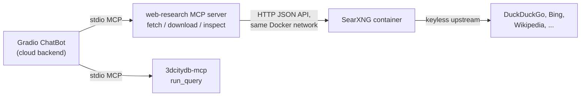

# Idea: Web Search & Document Inspection for the ChatBot

## Goal

Extend the ChatBot so that, beyond querying the 3DCityDB database via `run_query`,
it can:

1. **Search the web** for information not present in the database
   (e.g. "What does the CityGML 3.0 spec say about `roofType` codes?").
2. **Download files** (documentations, specifications, data dictionaries)
   into a local, inspectable store.
3. **Upload files** — the user attaches a document (PDF, CSV, zip, …) via a
   **"+" button to the left of the query entry field**, which is stored in the
   same per-user document store as fetched files.
4. **Inspect the stored files** (downloaded *or* uploaded) in chunks, so the
   model can answer questions grounded in the actual document content.

Typical user requests: *"Download the CityGML 3.0 encoding specification and
tell me which roof types are defined."* or (after uploading a file) *"Here is
our district's building register — how many buildings are of type
'office'?"*

## Required Capabilities (four distinct tools)

| Tool | Purpose |
|------|---------|
| `web_search(query)` | Ranked list of URLs + snippets for a query |
| `fetch_url(url)` | Pull a web page, convert HTML → clean markdown/text (size-capped) |
| `download_file(url)` / `upload_file(bytes, filename)` | Save a document (PDF, zip, …) to the per-user store — fetched from the web or uploaded by the user via the UI "+" button |
| `inspect_file(doc_id, offset, limit)` / `search_in_file(doc_id, pattern)` / `list_documents()` / `delete_documents(names)` | Read stored documents slice-by-slice, grep them for targeted lookups, browse them (including a structural outline for large files), and clean them up — see "Working with Large Documents" |

Key design point: **no off-the-shelf component does "download a binary and let
an LLM read it in chunks"** — the official `mcp-server-fetch` returns page *content*
and cannot handle binaries, and filesystem MCP servers can only read files that
already exist on a shared volume. The download + chunked-inspect part must be
custom-built in any variant below.

## Option A: Commercial search APIs (Tavily / Brave)

- **Tavily** (tavily.com) — search API designed for LLMs; clean snippets, dedup.
  Sign-up + API key; paid beyond a free tier.
- **Brave Search** (api.search.brave.app) — Brave's search API; also key +
  free credits, then paid.

**Verdict: rejected.** Both require the *user* to create an API key with an
external company, send queries to third-party servers, and incur per-query
costs. This conflicts with the self-hosted, no-external-dependency philosophy
of this project (local Ollama support, self-hosted Postgres, BYOD variant).

## Option B: SearXNG (recommended for the search step)

[SearXNG](https://github.com/searxng/searxng) is a self-hosted, open-source
metasearch engine. No API keys at all — it aggregates keyless upstream engines
(DuckDuckGo, Bing, Wikipedia, …). It exposes a local **JSON API**, and an
off-the-shelf MCP wrapper (`searxng-mcp`, Python, stdio) exists.

Architecture:



Docker-side additions (`docker-compose.*.yml`):

```yaml
services:
  searxng:
    image: searxng/searxng:latest
    volumes:
      - ./searxng/settings.yml:/etc/searxng/settings.yml:ro
    # no host ports needed if only the agent container consumes the API
```

with `settings.yml`:

```yaml
search:
  formats:
    - html
    - json        # critical — the JSON API is disabled by default
```

`.env` additions:

```dotenv
SEARXNG_BASE_URL=http://searxng:8888   # internal Docker network address
```

**Trade-offs of SearXNG:**

- ✅ No external dependency, no per-query cost, fully self-hosted.
- ⚠️ Upstream engines can throttle/block datacenter IPs intermittently
  (notably Google). Mitigation: enable a broad set of engines in
  `settings.yml` so no single engine being blocked breaks search.
- ⚠️ Result quality is raw (no LLM-tuned snippets) — post-process on the
  client side (e.g. truncate snippets to ~500 chars) to keep context small.
- 📝 Privacy: the bot itself is fully self-hosted, but upstream engines still
  see their share of the queries. Weight private engines
  (DuckDuckGo, Qwant, Startpage) higher if this matters.
- 💡 For the actual use case (document/spec lookup), direct URL fetching and
  Wikipedia-style reference lookups are often more reliable than any search
  ranking anyway — SearXNG is the discovery step, not the whole pipeline.

## Option C: Off-the-shelf MCP servers only

Combine `searxng-mcp` + official `mcp-server-fetch` + `mcp-server-filesystem`.

**Rejected.** Fragmented: three servers for one workflow, filesystem server
needs volume sharing with the WebUI container, and none of them provides the
download-binary → chunked-text-extraction glue. A single small custom server
is less total code and far less wiring.

## Recommended Design: One Small Custom MCP Server ("web-research")

Build one tiny MCP server exposing the tools below; fold the SearXNG call in
or keep `searxng-mcp` as a separate server for search:

```python
# tools (all operating on the bound user's document store — see "Per-user isolation")
web_search(query)                           → [{title, url, snippet}, ...]   (SearXNG JSON API)
fetch_url(url)                              → markdown text (trafilatura/bs4), size-capped
download_file(url, doc_id?)                 → saves to <store>/<user_id>/<doc_id>, returns {doc_id, size, mime}
upload_file(data, filename)                 → same, for user-uploaded files (bytes arrive via the WebUI)
list_documents()                            → [{doc_id, original_name, source, size, mime, last_accessed_at, outline}]
inspect_file(doc_id, offset=0, limit=4000)  → text slice (one-time extraction → <doc_id>.txt sidecar, then bounded reads)
search_in_file(doc_id, pattern)             → matching lines + ~500 chars context, capped at 20 matches
delete_documents(names: [doc_id, …])        → remove stored files (name-list semantics, like the scratchpad tools)
```

Items are addressed by a `doc_id` handle — the same handle/`name` principle as
the spatial scratchpad ([idea-for-future-spatial-scratchpad.md](idea-for-future-spatial-scratchpad.md)).
`download_file` takes an optional `doc_id`; when omitted the server derives an
identifier-like one from the filename (sanitized).

Reasons for an MCP server rather than plain Python functions in `webui/`:

- **Reusable** — immediately available to `server_sse.py` clients, MCP
  Inspector, VS Code, and any other agent, not just the Gradio bot.
- Keeps PDF-parsing dependencies (`pypdf`, `trafilatura`, …) out of the
  WebUI's dependency tree.

Counter-argument (honest alternative): if this is *only* ever needed by the
ChatBot, plain functions in `webui/` wired into the cloud backend's tool
dispatch are ~200 lines and skip subprocess/session management. Both are
reasonable; the MCP route is more future-proof for this codebase.

## Integration Touchpoints (WebUI-side)

The WebUI currently assumes a single tool (`run_query`). For web research to
work, these need to become tool-agnostic (details in
[idea-for-future-multiple-MCP-servers.md](idea-for-future-multiple-MCP-servers.md)):

- `production/webui/mcp_client.py` — spawn/connect additional server(s),
  route tool calls by name.
- `production/webui/backends/cloud.py` — replace the hard-coded
  `tools=[RUN_QUERY_TOOL]` with a merged tool list; dispatch by tool name
  instead of assuming `args["sql"]`.
- `production/webui/app.py` — the `tool_executor=lambda sql: …` becomes a
  generic dispatcher; `_render_tool_call` should show tool name + JSON args
  instead of a forced ```sql fence. Additionally: a small **"+" button** left
  of the chat input (`gr.File(count=1, interactive=True)`) whose upload is
  routed into the web-research server's `upload_file` tool for the bound
  user.
- **System prompt** — append a short "Web research" section (the CityGML
  part stays from `assemble_prompt`): when to search vs. query the DB, how to
  work through large documents (outline from `list_documents()` →
  `search_in_file` → bounded `inspect_file` slices), and to never present
  unverified web content as database facts.
- **Tool-result cache** — `_build_tool_cache` is SQL-specific; for web tools
  either skip caching or store a URL/summary instead.
- **`.env`** — server toggles/commands + `WEB_DOCS_EXPIRY_DAYS` (the files
  themselves live under the existing `./data` bind mount, which already
  survives container restarts — no new volume needed).

## Working with Large Documents (they will not fit the context window)

The design premise: **the document never enters the context whole — only
small, model-directed windows do.** A 300-page specification is a *resource*
the model pages through, not a *message*. Several mechanisms layer on top of
each other:

**1. Bounded slices are the contract, not a fallback.**
`inspect_file(doc_id, offset, limit)` always returns at most ~3–4k characters
(plus a trailer: `… of {total_chars} chars total; use offset={next} to
continue`). `fetch_url` results are capped similarly (~30k chars) before
entering context. The ceiling is hard and enforced in the tool layer — the
model cannot request more, even in principle. This chunking design matters
more than any other detail: it determines whether "download this spec and
tell me how X is defined" works at all.

**2. A cheap structural index at store time (never full text extraction).**
When a file is downloaded or uploaded, the server does one cheap parse pass
and stores a small **outline** in `_catalog.json`:

- PDF → page count + bookmark/TOC entries (via `pypdf`, no text extraction)
- text/markdown → heading list with character offsets
- CSV → column headers + row count (first few rows only)
- zip → file listing with sizes

`list_documents()` and the `upload_file` / `download_file` results include
this outline, so the model "sees the shape" of a 300-page spec for a few
hundred characters and can jump straight to the interesting region.

**3. One-time full extraction, cached on disk.**
For formats where slicing needs extracted text (PDF), the first
`inspect_file` call extracts the text **once** into a sidecar file
(`<doc_id>.txt` next to the document); all later calls are plain bounded
reads of that file. Paging 20 times through a spec is 20 cheap file reads,
not 20 re-parses.

**4. `search_in_file(doc_id, pattern)` for targeted lookup.**
Blind paging through a large document is wasteful, so the server adds a
plain-text search over the extracted text returning *matching lines with
~500 chars of surrounding context*, capped (e.g. first 20 matches, then
"… N more — narrow the pattern"). This is the workhorse for "which section
defines `roofType`?" and mirrors what `grep` does in an IDE.

**5. The WebUI context budget is the last line of defense.**
`trim_messages` in [chat_runtime.py](../webui/chat_runtime.py) already drops
the oldest non-system turns when the assembled input exceeds the provider's
context limit (80% of the model's limit, otherwise the 400k-char budget).
Because slices are small, trimming a turn only loses a few kilobytes of
document content — and that content is **re-fetchable**: the file persists in
the store and the model can read it back on demand. This is the key
difference from a giant SQL result — document content is cheap to drop from
context.

**6. Findings live in the chat (or the scratchpad), the document lives on
disk.**
For long analyses the model summarizes what it has established into its
replies (which stay in context longer than old tool results under the
trimming policy) and, once the
[spatial scratchpad](idea-for-future-spatial-scratchpad.md) exists, it can
persist durable intermediate results as scratchpad items — so a "read 50
pages of spec, extract every code value, store as `spec_codes`" workflow
survives even a full context reset.

**Prompt guidance** (part of the system-prompt section): *For large stored
documents, do not page from the beginning. Use the outline from
`list_documents()` to locate the relevant region, use `search_in_file` to
confirm it, then `inspect_file` with `offset` around the match. Re-read only
what the answer still needs.*

**Honest caveat:** for a *very* large document where the answer requires
synthesizing across many sections (e.g. "list all code values defined
anywhere in the spec"), ReAct paging is slow and token-expensive. That is an
inherent property of in-context reading without a retrieval index, and the
extract → store (scratchpad) → query-the-store workflow above is the
mitigation.

## Security Considerations

The model decides which URLs get fetched:

- Enforce **HTTPS + size caps** (e.g. 50 MB max download *and* per upload).
- **Sandbox downloads** to the bound user's store directory only; never
  execute downloaded content.
- **SSRF protection**: block private/resolved-internal IP ranges (a steered
  model could otherwise reach `http://169.254.169.254` or the internal
  Postgres host).
- **Upload guardrails**: enforce an extension/MIME allow-list (e.g. `pdf`,
  `zip`, `txt`, `md`, `csv`, `geojson`), sanitize filenames, and store the
  file under the generated `doc_id` on disk — the original name lives only
  in the catalog for display.
- Keep fetches **uncached** by default (stale content is worse than a refetch).

## Per-user Isolation

The chatbot runs as a **multi-user shared service**. Search results are
transient (they live only in one session's in-memory message list and are
already isolated), but **fetched and uploaded files are durable on disk** —
without isolation, user A could `inspect_file` a document user B
downloaded.

**Store layout:** per-user subdirectories under the existing `./data` bind
mount (present in both the fullstack and the BYOD compose files):

```
/app/data/webdocs/
├── <user_id-A>/
│   ├── _catalog.json      # doc_id → {original_name, source, mime, size,
│   │                      #            uploaded_at, last_accessed_at,
│   │                      #            outline}
│   └── <doc_id>           # the file, addressed by doc_id
└── <user_id-B>/
    ├── _catalog.json
    └── <doc_id>
```

The WebUI's `mcp_client` already isolates per-user tool calls by injecting
the user context (the identity mechanism is specified in
[idea-for-future-spatial-scratchpad.md](idea-for-future-spatial-scratchpad.md),
*Identity without login*) — the web-research server simply resolves the
caller's `user_id` from that same context (server-injected, never from model
args) and confines every path to `/app/data/webdocs/<user_id>/`. All path
access goes through a single `resolve(user_id, doc_id)` helper that rejects
traversal (`..`, absolute paths, names outside the `doc_id` character set).

A **database catalog table** (RLS, like the scratchpad) was considered and
**rejected**: it requires DDL plus a second, writable Postgres credential —
which breaks the BYOD configuration, where the database is an external
system the user does not own. The disk layout above is variant-agnostic and
needs no database at all. Residual gap: someone with container shell access
could read other users' files — that is a higher-privilege threat than the
one this feature introduces and is acceptable.

## Staleness & Cleanup

Stored files (fetched *and* uploaded) should not accumulate forever. The
mechanism mirrors the scratchpad's expiry, operating on the file system
instead of table rows:

- **Per-document `last_accessed_at`** — bumped every time the model calls
  `inspect_file` on the document (a document the model never opens is the
  primary deletion candidate).
- **Per-user `last_seen`** — bumped on every chat turn, same as the
  scratchpad; a user whose identity goes stale has their whole directory
  swept.
- **`WEB_DOCS_EXPIRY_DAYS=14`** (configurable, `0` disables) — files not
  accessed (and users not seen) beyond the threshold are deleted: remove the
  files and drop their catalog entries; drop the user directory once empty.
- **Executor** — the *same* WebUI `threading.Timer` that runs the scratchpad
  purge (startup + daily reschedule, see
  [idea-for-future-spatial-scratchpad.md](idea-for-future-spatial-scratchpad.md))
  also runs this sweep, so one daemon thread covers both features.
  It is pure file-system work — no DDL, no extra database role, so it works
  identically in BYOD.

## Known Limitation

The local (Ollama) backend's ReAct parser in `production/webui/backends/local.py`
is hard-wired to `run_query` — so web tools initially work **only with
Anthropic/OpenAI models** until that parser is generalized.

## Estimated Effort

| Piece | Effort |
|-------|--------|
| SearXNG container + `settings.yml` | ~1 hour |
| `web-research` MCP server (search/fetch + per-user store, download/upload, outline extraction, chunked inspect, `search_in_file`, list/delete, ~400–500 lines) | ~1 day |
| WebUI integration (tool-agnostic dispatch in `cloud.py` / `app.py` / `mcp_client.py`) + "+" upload button | ~1 day (overlaps with the multi-MCP-server work) |
| System-prompt section + UI rendering for non-SQL tool calls | a few hours |
| Staleness sweep (shares the scratchpad's `threading.Timer`) | a few hours |

**Total: roughly 3–4 working days**, with the multi-server plumbing shared
with [idea-for-future-multiple-MCP-servers.md](idea-for-future-multiple-MCP-servers.md)
and the identity / purge plumbing shared with
[idea-for-future-spatial-scratchpad.md](idea-for-future-spatial-scratchpad.md).

## Suggested Build Order

1. Get `inspect_file` chunking + outline + `search_in_file` right (they
   dictate the large-document workflow).
2. Per-user store layout + `_catalog.json` + path-resolution guard.
3. SearXNG container + `web_search`.
4. `fetch_url` (trafilatura).
5. `download_file` + security guards (SSRF, size caps).
6. WebUI "+" button + `upload_file`.
7. Staleness sweep in the shared timer.
8. WebUI integration + prompt section + UI rendering.
